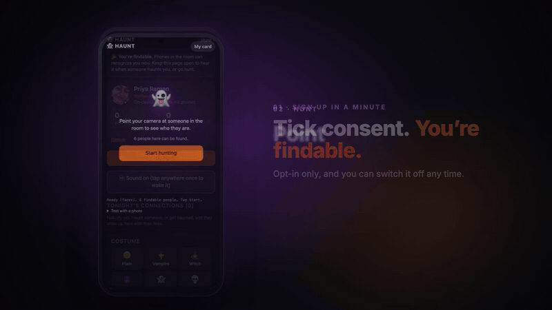
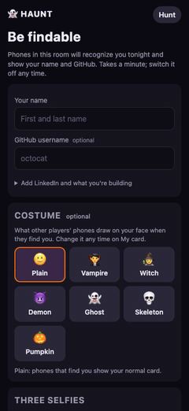
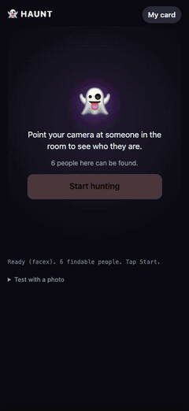
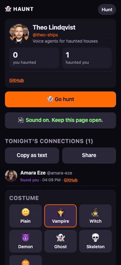
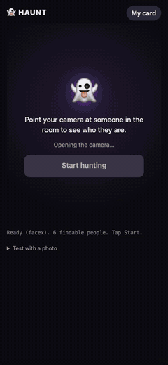
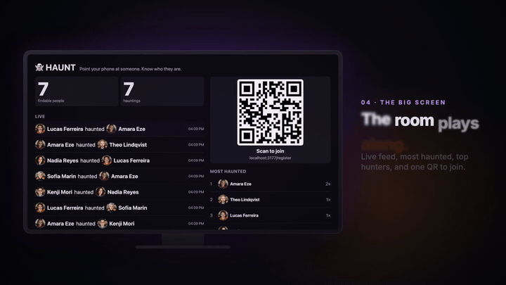
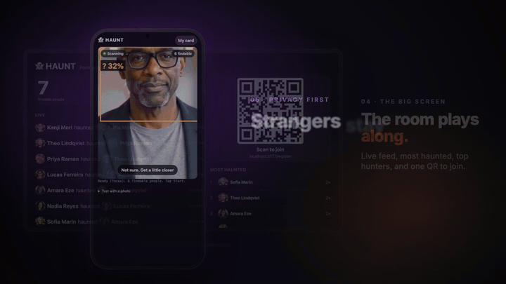
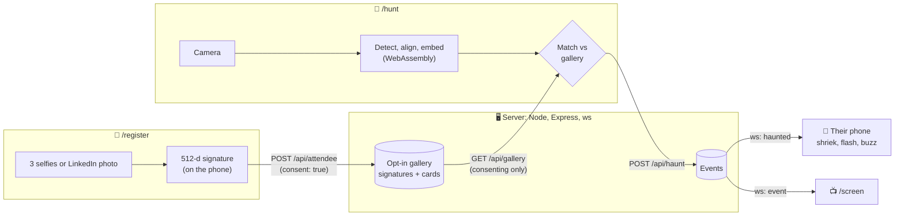

<div align="center">

# 👻 HAUNT

### Point your phone at someone in the room. Know who they are.

Opt-in face recognition for events, running entirely on the phone.<br>
No app to install: one link that works in iOS Safari and Android Chrome.

[](https://strangerbuilds.com)

[](https://aura-haunt.fly.dev)
[](https://mthomas100.github.io/haunt/)
[](https://github.com/mthomas100/haunt/actions/workflows/ci.yml)




**[Try it live](https://aura-haunt.fly.dev)** &nbsp;·&nbsp; **[Watch the film](https://mthomas100.github.io/haunt/)** &nbsp;·&nbsp; **[How it works](#how-it-works)** &nbsp;·&nbsp; **[Privacy](#privacy-is-the-product)** &nbsp;·&nbsp; **[Run your own](#run-your-own)**

</div>

> [!IMPORTANT]
> **🏆 Top 3 at Stranger Builds**, the Halloween hackathon of October 31, 2026. HAUNT went from an empty folder to a
> live HTTPS app in one day, built by three people and a crew of coding agents.

## A room full of builders, and you know none of their names

Name tags fall off. Badges face the wrong way. You can't search LinkedIn for "the person in the vampire cape who
knows WebGPU."

HAUNT fixes the first ten seconds of every conversation. Everyone who wants to be found signs up with a selfie and
a profile. Then any phone in the room can point its camera at a person and get their name, what they're building,
and their GitHub and LinkedIn. Finding someone **haunts** them: their phone shrieks, flashes and buzzes with who
found them, and you both leave with each other's card.

## How it works

<table>
<tr>
<td align="center" width="25%"><br><b>1 · Sign up in a minute</b><br><sub>Scan the QR. Name, GitHub, a costume, three selfies, tick consent. Or sign in with LinkedIn and your photo is the selfie.</sub></td>
<td align="center" width="25%"><br><b>2 · Point your phone</b><br><sub>The camera finds them, draws the costume they picked on their face, and shows their card. Tap <b>Haunt</b>.</sub></td>
<td align="center" width="25%"><br><b>3 · Their phone shrieks</b><br><sub>Sound, a flash and a buzz, with who found them. One tap on <b>Haunt back</b> and you're even.</sub></td>
<td align="center" width="25%"><br><b>4 · Gone in one tap</b><br><sub>Had enough? Turn Findable off and every phone in the room stops naming you, at once.</sub></td>
</tr>
</table>

## What's inside

- 🧛 **Costume lenses.** Vampire, Witch, Demon, Ghost, Skeleton or Pumpkin, painted onto your face on other people's
  phones: a 468-point face mesh, irises that blink with you, fangs that show when you open your mouth, 3D bats and
  hats posed with your head. MediaPipe and WebGL, on the hunter's phone.
- 👻 **Haunt and haunt back.** A WebSocket push makes the found person's phone shriek, flash and vibrate within a beat.
- 📺 **The big screen.** `/screen` on the venue TV: a live feed of who haunted whom, most haunted, top hunters, and the
  join QR.
- 🔗 **Tonight's connections.** `/me` keeps everyone you found and everyone who found you, with GitHub and LinkedIn
  links. One tap copies the list.
- 🔑 **Sign in four ways.** GitHub, LinkedIn, Google or Apple. With LinkedIn, your profile photo becomes your face
  signature and selfies are optional.
- 🕵️ **The Scout.** A matchmaking agent (Fetch.ai track) pairs people who could build together, sends each a *clue*
  instead of a name, lets the camera find them, and asks both afterwards whether the match was any good. It works from
  profiles and events, never faces.
- 🥽 **Apple Vision Pro.** visionOS Safari can't hand the camera to a web page, so `/hunt` switches to snap mode: take
  a screenshot of what you see and HAUNT finds the faces in it.
- 🛠️ **Organizer tools.** `/admin` (block, delete, message attendees, open and close events), `/enroll` (bulk enroll
  from a CSV and photos), `/calibrate` (the pairwise similarity matrix for tuning the threshold).

<div align="center">

<br><sub>The room plays along: <code>/screen</code> on the TV updates live as people haunt each other.</sub>
</div>

## Privacy is the product

A face-recognition app at a party only works if nobody has to trust it. So the rules are enforced in code, not policy:

- **Matching runs on the phone.** A face detector, landmarks, an aligned crop, and a 7 MB open-source embedder
  (EdgeFace-XS, compiled to WebAssembly) turn a face into 512 numbers. Video never leaves the device. The server only
  ever sees those signatures, profile cards and events.
- **Opt-in, enforced by the server.** The gallery that phones match against contains only people who ticked consent.
  Consent is a server-side filter, not a checkbox in the UI.
- **Strangers stay strangers.** A face that isn't registered is shown as `unknown`. It is never named and never stored.
- **A kill switch that works.** Turn Findable off, or tap "Forget me", and you vanish from every open phone
  instantly: a WebSocket push, not a refresh. Organizers can delete any record from `/admin`.
- **No face goes to an AI model.** No image or face signature is ever sent to a hosted LLM. The agents work from
  events and profiles only.
- **Built to be deleted.** One JSON file on one volume. Delete it after the event.

<div align="center">

</div>

## How the matching holds up

| | |
|---|---|
| **Pipeline** | Human detector + FaceMesh landmarks → our own similarity-transform alignment → FaceX EdgeFace-XS → 512-d signature → cosine similarity against the opt-in gallery |
| **Same person** | 0.47 to 0.79, across photos taken years apart |
| **Strangers** | at most 0.36 |
| **Threshold** | 0.40 to show a name. Between 0.30 and 0.40 the phone says "Not sure. Get a little closer" instead of guessing, and a name has to win three frames in a row before the card opens |
| **Models** | about 9 MB for detection and landmarks (Human) plus 7 MB for the embedder (FaceX), cached after the first load |

A wrong name on a stranger is the failure HAUNT is tuned against: it would rather say "unknown" than guess.
[RESEARCH.md](RESEARCH.md) section D has the measurements and what didn't work.

## Architecture



One Node process serves the static pages, the API and the WebSocket; storage is a JSON file. No build step: the pages
are plain ES modules. Contract and data model: [ARCHITECTURE.md](ARCHITECTURE.md). Sequence diagrams and every
socket message: [docs/DIAGRAM.md](docs/DIAGRAM.md).

## Run your own

Needs Node 22 or newer.

```bash
git clone https://github.com/mthomas100/haunt && cd haunt
npm install
npm start           # http://localhost:3000 (FaceX weights download on first start)
npm run tunnel      # phones need HTTPS for the camera: prints a https://*.trycloudflare.com URL
npm test            # smoke test: API, pushes, consent filter, kill switch, costumes, the Scout
```

Then open `/register` on one phone, `/hunt` on another, and `/screen` on a laptop or TV.

- **Deploy** to Fly.io in one command: [docs/DEPLOY.md](docs/DEPLOY.md). The machine sleeps when idle and a monthly
  data cap keeps the worst month under $6.
- **Configure** sign-in providers and the admin token: [.env.example](.env.example) and [docs/OAUTH_SETUP.md](docs/OAUTH_SETUP.md).
  Everything is optional; with no keys you get the name + selfie path and no sign-in buttons.
- **Run the event**: the two-minute demo script and the questions people ask are in [docs/DEMO.md](docs/DEMO.md).

## Built at Stranger Builds

HAUNT was built on October 31, 2026 at **[Stranger Builds](https://strangerbuilds.com)**, a Halloween hackathon (one
day in person, seven days to ship), and placed **in the top 3**.

**Team:** Matthew Thomas ([@mthomas100](https://github.com/mthomas100)), [@tarecq](https://github.com/tarecq) and
[@chaltenio](https://github.com/chaltenio). The hackathon repo, with its full commit history, is
[chaltenio/aura](https://github.com/chaltenio/aura).

**Built with agents.** Several Claude Code sessions worked in parallel, one branch and one task each, kept in sync
by a GitHub-issue message bus and an integrator agent that reviewed and landed every branch. The rule that kept it
honest: no face or face signature ever goes to a hosted model, so the agents wrote the code but never saw a face.

**About the film and the clips above:** every person in them is AI-generated. The app, the code and the recordings
are real: simulated attendees ran the real pages in headless Chrome, each with a fake camera, against a local server.

**Stack:** Node 22, Express, ws · FaceX (EdgeFace-XS, WebAssembly) · Human · MediaPipe Face Landmarker · three.js /
WebGL · Fly.io · Remotion for the film.

<details>
<summary><b>Docs</b></summary>

- [ARCHITECTURE.md](ARCHITECTURE.md): components, data model, the API contract, privacy posture, failure modes
- [docs/DIAGRAM.md](docs/DIAGRAM.md): system and sequence diagrams, every HTTP route and socket message
- [RESEARCH.md](RESEARCH.md): browser face recognition prior art and measurements, real-time infra, sponsor tracks
- [docs/scout/](docs/scout/README.md): how the Scout scores pairs, writes clues and learns from ratings
- [docs/DEPLOY.md](docs/DEPLOY.md), [docs/OAUTH_SETUP.md](docs/OAUTH_SETUP.md), [docs/DEMO.md](docs/DEMO.md)

</details>

<details>
<summary><b>Third-party code</b></summary>

- [FaceX](https://github.com/facex-engine/facex) (Apache-2.0), vendored in `web/vendor/facex/` with its license; weights fetched from its release
- MediaPipe canonical face model (Apache-2.0, Google), converted in `web/vendor/facegeom.js`
- Loaded from a CDN at runtime: [Human](https://github.com/vladmandic/human) (MIT), [MediaPipe Tasks Vision](https://github.com/google-ai-edge/mediapipe) (Apache-2.0), [three.js](https://github.com/mrdoob/three.js) (MIT), [qrcode-generator](https://github.com/kazuhikoarase/qrcode-generator) (MIT)

</details>

<div align="center">
<br>
<a href="https://aura-haunt.fly.dev"><b>👻 Try it live</b></a> &nbsp;·&nbsp; <a href="https://mthomas100.github.io/haunt/"><b>Watch the film</b></a>
</div>
